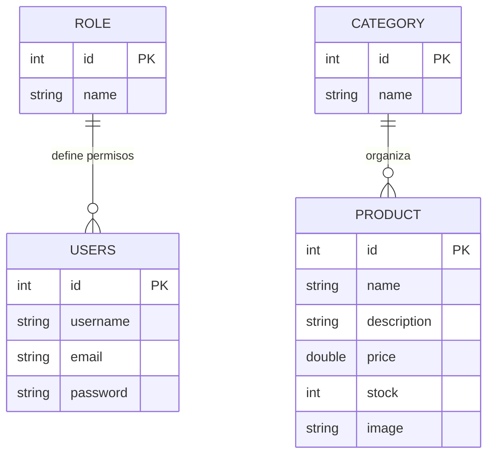

# TiendaMTB

**Plataforma e-commerce especializada en componentes y equipamiento de ciclismo de montaña**, diseñada bajo una arquitectura **Java Enterprise MVC** con foco en la claridad de navegación, la seguridad de acceso y la mantenibilidad del código.


---

## Enfoque del Proyecto

Más allá de implementar un catálogo funcional, el desarrollo se ha centrado en resolver tres aspectos clave de cualquier producto digital real:

* **Experiencia de usuario consistente:** Uso de una arquitectura de vistas modular (`template.jsp`) y diseño responsivo con Bootstrap, asegurando coherencia visual y tiempos de carga ligeros en cualquier dispositivo.
* **Resiliencia ante fallos:** Gestión controlada de excepciones y rutas no válidas (`error.jsp`), evitando exponer trazas técnicas al usuario final y ofreciendo siempre una salida clara.
* **Seguridad y gobierno de datos:** Separación estricta entre navegación pública, gestión de perfil de cliente y operaciones críticas de administración mediante control de acceso basado en roles (RBAC) y cifrado de credenciales (`PasswordUtils`).

---

## Arquitectura y Modelo de Datos

La aplicación desacopla el enrutamiento HTTP (**Servlets**), la lógica de dominio y persistencia (**JPA**) y la capa de presentación (**JSP**), facilitando que cualquier desarrollador pueda escalar o mantener un módulo sin afectar al resto.



### Mapa de Controladores

| Endpoint | Controlador | Responsabilidad | Nivel de Acceso |
| :--- | :--- | :--- | :--- |
| `/home` | `HomeController` | Vista principal y escaparate destacado | Público |
| `/products` | `ProductsController` | Exploración por categorías y ficha técnica de producto | Público |
| `/auth` | `AuthController` | Autenticación, gestión de sesión y cierre seguro | Público |
| `/users` | `UserController` | Registro de clientes y mantenimiento de cuenta | Cliente |
| `/admin` | `AdminController` | Gestión de inventario (CRUD) y promoción de roles | Administrador |

---

## Estructura del Repositorio

```text
TiendaMTB/
├── setup/
│   └── glassfish-resources.xml   # Definición de pool de conexiones y recursos JDBC
├── src/
│   ├── conf/
│   │   └── persistence.xml       # Configuración de la unidad de persistencia JPA
│   └── java/
│       ├── data.sql              # Seed inicial de roles, usuarios y catálogo MTB
│       └── tienda/
│           ├── controlador/      # Servlets (enrutamiento y control de flujo)
│           ├── modelo/           # Entidades JPA (Category, Product, Role, Users)
│           └── util/             # Seguridad (PasswordUtils) y helpers (UserUtils)
├── web/
│   ├── WEB-INF/
│   │   ├── glassfish-web.xml   # Descriptor de despliegue
│   │   └── views/                # Vistas JSP desacopladas del acceso directo
│   ├── css/                      # Bootstrap + hoja de estilos personalizada (main.css)
│   └── img/                      # Recursos gráficos del catálogo
└── build.xml                   # Automatización de empaquetado (.war) con Apache Ant
```

---

## Puesta en Marcha

> [!NOTE]
> El proyecto está preparado para importarse y desplegarse directamente desde **Apache NetBeans** sobre **GlassFish Server**, aunque puede compilarse desde terminal mediante **Apache Ant**.

1. **Preparar el servidor y la base de datos**
   * Arranca tu instancia local de **GlassFish** y registra el pool JDBC definido en `setup/glassfish-resources.xml`.
   * Verifica que el *DataSource* coincida con el declarado en `src/conf/persistence.xml`.
   * Ejecuta `src/java/data.sql` sobre tu base de datos para cargar los datos iniciales de prueba.

2. **Compilar y desplegar**
   * Abre el proyecto en **Apache NetBeans** y ejecuta **Clean and Build** (o lanza `ant dist` desde la raíz para generar el `.war` en `dist/`).
   * Despliega la aplicación y accede desde el navegador a:
     ```text
     http://localhost:8080/TiendaMTB/
     ```

---

## Próximos Pasos (Roadmap)

* [ ] Incorporar carrito de compra persistente en sesión y flujo completo de *checkout*.
* [ ] Migrar la carga de filtros del catálogo a peticiones asíncronas (`Fetch API` / JSON) para evitar recargas de página.
* [ ] Añadir contenedorización con `Docker` y `docker-compose` (GlassFish + Base de Datos) para despliegue en un solo comando.

---

## Autoría

Desarrollado por **Manuel Martín Rodrigo** ([@manuelmr7](https://github.com/manuelmr7)) como proyecto de ingeniería de software en el **Grado en Ingeniería Informática** de la **Universidad de Huelva (UHU)**.
