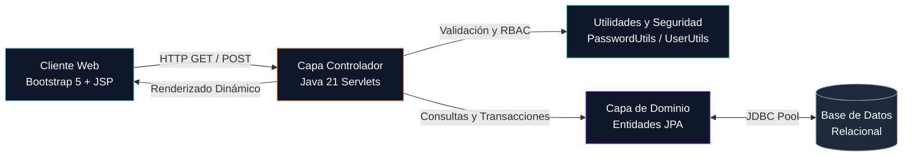

<div align="center">

# TiendaMTB

**Plataforma e-commerce de componentes y equipamiento de ciclismo de montaña**, construida sobre **Java 21** y **Jakarta EE** con arquitectura MVC, control de acceso por roles y diseño responsivo.

<p>
  <a href="#pilares-del-producto">Pilares</a> •
  <a href="#arquitectura-y-flujo">Arquitectura</a> •
  <a href="#modelo-de-datos">Modelo de Datos</a> •
  <a href="#endpoints">Endpoints</a> •
  <a href="#puesta-en-marcha">Puesta en Marcha</a> •
  <a href="#roadmap">Roadmap</a>
</p>


</div>

---

## Pilares del Producto

| Experiencia de Usuario (UX) | Seguridad y Gobierno | Ingeniería y Mantenibilidad |
| :--- | :--- | :--- |
| Interfaz limpia y adaptable con **Bootstrap 5** y plantilla maestra (`template.jsp`) que garantiza consistencia visual en catálogo, fichas y formularios. | Control de acceso basado en roles (**RBAC**) con separación estricta entre navegación pública, área de cliente y panel administrativo, más cifrado en `PasswordUtils`. | Desacoplamiento total entre enrutamiento (**Servlets**), dominio (**JPA**) y vistas (**JSP**), con manejo controlado de errores (`error.jsp`). |

---

## Arquitectura y Flujo

El sistema organiza cada petición HTTP siguiendo un flujo unidireccional claro, facilitando la trazabilidad y el mantenimiento colaborativo del código:



---

## Modelo de Datos


---

## Endpoints

| Ruta | Controlador | Responsabilidad | Acceso |
| :--- | :--- | :--- | :--- |
| **`/home`** | `HomeController` | Vista principal y escaparate de productos destacados | `Público` |
| **`/products`** | `ProductsController` | Exploración del catálogo por categorías y detalle técnico | `Público` |
| **`/auth`** | `AuthController` | Inicio de sesión, validación de credenciales y cierre seguro | `Público` |
| **`/users`** | `UserController` | Registro de nuevos clientes y gestión de perfil | `Cliente` |
| **`/admin`** | `AdminController` | Gestión integral del catálogo (CRUD) y promoción de roles | `Admin` |

---

## Estructura del Repositorio

<details>
<summary><strong>Desplegar árbol completo de directorios</strong></summary>

```text
TiendaMTB/
├── setup/
│   └── glassfish-resources.xml   # Pool de conexiones y recursos JDBC para GlassFish 8
├── src/
│   ├── conf/
│   │   └── persistence.xml       # Unidad de persistencia Jakarta Persistence (JPA)
│   └── java/
│       ├── data.sql              # Seed inicial de roles, usuarios y catálogo MTB
│       └── tienda/
│           ├── controlador/      # Servlets (enrutamiento y control de flujo MVC)
│           │   ├── AdminController.java
│           │   ├── AuthController.java
│           │   ├── HomeController.java
│           │   ├── ProductsController.java
│           │   └── UserController.java
│           ├── modelo/           # Entidades JPA del dominio
│           │   ├── Category.java
│           │   ├── Product.java
│           │   ├── Role.java
│           │   └── Users.java
│           └── util/             # Seguridad y gestión de usuarios
│               ├── PasswordUtils.java
│               └── UserUtils.java
├── web/
│   ├── WEB-INF/
│   │   ├── glassfish-web.xml   # Descriptor de despliegue en GlassFish 8
│   │   └── views/                # Vistas JSP protegidas contra acceso directo
│   ├── css/                      # Bootstrap 5 + estilos propios (main.css)
│   └── img/                      # Recursos gráficos del catálogo
└── build.xml                   # Automatización de empaquetado (.war) con Apache Ant
```

</details>

---

## Puesta en Marcha

> [!IMPORTANT]
> Asegúrate de tener configurado **JDK 21** como runtime activo en **GlassFish Server 8** antes de registrar los recursos JDBC o desplegar el `.war`.

### 1. Configuración de Base de Datos
1. Inicia **GlassFish 8** y registra el pool de conexiones definido en `setup/glassfish-resources.xml`.
2. Verifica que el nombre JNDI del *DataSource* coincida con el declarado en `src/conf/persistence.xml`.
3. Ejecuta el script `src/java/data.sql` en tu gestor de base de datos para cargar los roles, usuarios y productos iniciales.

### 2. Compilación y Despliegue
Puedes abrir el proyecto directamente en **Apache NetBeans** (`Clean and Build` → `Run`) o generar el artefacto desde terminal mediante **Apache Ant**:

```bash
ant dist
```

Una vez desplegado en GlassFish, accede a la aplicación en:

```text
http://localhost:8080/TiendaMTB/
```

---

## Roadmap

- [ ] **Carrito y Checkout:** Persistencia de cesta en sesión y flujo completo de confirmación de pedido.
- [ ] **Filtrado Asíncrono:** Carga dinámica de productos por categoría mediante `Fetch API` y respuestas JSON sin recarga de página.
- [ ] **Entorno Contenedorizado:** Configuración con `Docker` y `docker-compose` (GlassFish 8 + Base de Datos) para despliegue en un único comando.

---

<div align="center">

Desarrollado por **Manuel Martín Rodrigo** ([@manuelmr7](https://github.com/manuelmr7))  
Grado en Ingeniería Informática · **Universidad de Huelva (UHU)**

</div>
